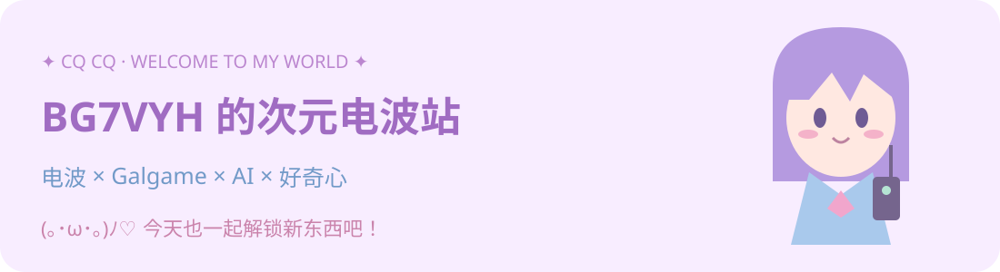

# ✨ 欢迎来到我的存档点 ✨

**(｡･ω･｡)ﾉ♡ 这里是 BG7VYH，正在接收世界的新鲜信号！**

✦ ── ⋆｡˚ 🌸 ˚｡⋆ ── ✦

### 📖 人物档案 · About Me

| 频道 | 正在播放 |
| :---: | :--- |
| 📡 电波频道 | 业余无线电爱好者 · 呼号 **BG7VYH**，期待电波带来的相遇！ |
| 🎮 故事频道 | 平常喜欢玩 **Galgame**，在文字与音乐里遇见不同的故事。 |
| 🤖 探索频道 | 正在探索 **如何使用 AI**，一边尝试，一边积累经验。 |
| 🌱 成长频道 | 乐于接触和学习新事物，保持好奇，慢慢升级！ |

### 🎀 好感度事件 · Choose Your Route

`📡 聊聊无线电`　`🌸 分享喜欢的故事`　`🤖 交流 AI 新玩法`

**▷ 你发现了一位愿意一起学习、一起探索的同伴！**

(ﾉ◕ヮ◕)ﾉ*:･ﾟ✧

> 💬 **BG7VYH：**「未知的东西还有很多，所以明天也很值得期待呀。」

💌 点击拆开电波来信 (つ≧▽≦)つ

嗨，路过的朋友！无论你是被无线电、Galgame，还是 AI 吸引到这里，都欢迎来交流。技术可以慢慢学，好奇心要好好保留。希望我们都能在喜欢的事情里，找到新的快乐。♡

✦ ── ⋆｡˚ 🛸 ˚｡⋆ ── ✦

**Thanks for visiting · 感谢接收我的信号**

**73 de BG7VYH** 📡 💜

下一次相遇，会解锁怎样的新剧情呢？

